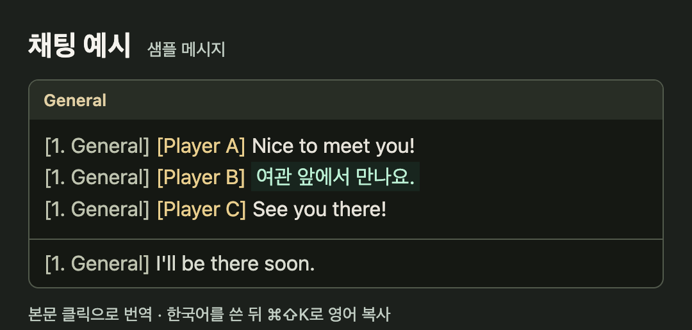

# WoW Forever Konglish

북미 와우 채팅을 한국어로 읽고 영어로 답하는 Mac 앱. 로그인 없이 Mac에서 번역합니다.

## 설치

[Mac 앱 다운로드](https://github.com/CodeNyangi/wowforever-konglish/releases/latest)에서 ZIP을 풀고 **Konglish.app**을 **응용 프로그램**으로 옮기세요. 배포 ZIP은 Apple Silicon과 macOS 26 이상용입니다.

**시스템 설정 → 일반 → 언어 및 지역 → 번역 언어**에서 **English (US)**와 **Korean**을 내려받으세요.

배포 ZIP에는 Apple 공증이 없어 macOS가 처음 열 때 차단할 수 있습니다. [Apple의 앱 열기 안내](https://support.apple.com/ko-kr/102445)

## 사용법

1. **Konglish → 와우 채팅 연결**을 누르고 와우 창을 공유한 뒤 채팅 영역을 드래그합니다.
2. **받은 말**은 채팅 본문을 클릭해 번역합니다. 다시 클릭하면 원문이 보입니다.
3. **보낼 말**은 와우 채팅칸에 한국어를 쓰고 **⌘⇧K**를 누릅니다. 같은 칸에서 **⌘A → ⌘V**로 영어를 붙이고 Return으로 보냅니다.




## 소스에서 설치

Node.js 22.12 이상과 macOS 26 SDK가 필요합니다.

```sh
npm ci
npm run install:mac
npm test
npm run test:overlay
```

일부 약어만 풀이하는 독립 Lua 애드온도 [addon/Konglish](addon/Konglish)에 있습니다. 전체 문장 번역은 Mac 앱에서 동작합니다.

[MIT 라이선스](LICENSE)
