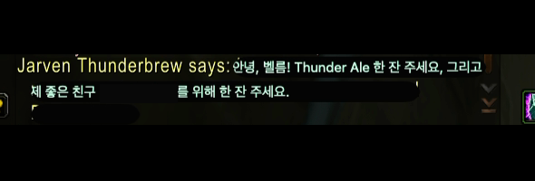
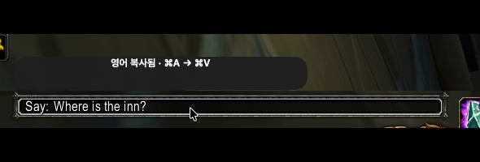

# WoW Forever Konglish

북미 와우 채팅을 한국어로 읽고 영어로 답하는 무료 Mac 앱입니다.

**Mac 기본 오프라인 번역**을 써서 반응이 빠르고, 로그인이나 번역 구독료가 없습니다. 표현이 조금 어색해도 뜻을 알아듣고 대화할 수 있으면 된다는 생각으로 만들었습니다.

## 설치

[Mac 앱 다운로드](https://github.com/CodeNyangi/wowforever-konglish/releases/latest)에서 ZIP을 풀고 **Konglish.app**을 **응용 프로그램**으로 옮기세요. 배포 ZIP은 Apple Silicon과 macOS 26 이상용입니다.

**시스템 설정 → 일반 → 언어 및 지역 → 번역 언어**에서 **English (US)**와 **Korean**을 내려받으세요.

배포 ZIP에는 Apple 공증이 없어 macOS가 처음 열 때 차단할 수 있습니다. [Apple의 앱 열기 안내](https://support.apple.com/ko-kr/102445)

## 사용법

1. **Konglish → 와우 채팅 연결**을 누르고 와우 창을 공유한 뒤 채팅 영역을 드래그합니다.
2. **받은 말**은 채팅 본문을 클릭해 번역합니다. 다시 클릭하면 원문이 보입니다.
3. **보낼 말**은 와우 채팅칸에 한국어를 쓰고 **⌘⇧K**를 누릅니다. 같은 칸에서 **⌘A → ⌘V**로 영어를 붙이고 Return으로 보냅니다.


실제 와우에서 **영어 본문 클릭 → 한국어**, **한국어 입력 → 영어**로 바꾸는 모습을 6초로 편집했습니다. 플레이어 이름만 가리고, 채팅 본문·입력칸·완료 안내가 잘 보이도록 화면을 잘랐습니다.

| 영어 채팅을 한국어로 | 한국어 입력을 영어로 · 완료 안내 |
| --- | --- |
|  |  |

[실제 인게임 영상 보기 · 6초 MP4, 약 40KB](https://github.com/CodeNyangi/wowforever-konglish/releases/download/v0.1.1/konglish-6s-demo.mp4)

## 업데이트

v0.1.1부터 새 버전을 자동으로 확인하고 받아둡니다. 와우 사용 중에는 재시작하지 않으며, **Konglish를 다음에 실행할 때 적용**합니다. 메뉴 막대의 Konglish에서 **업데이트 확인**과 **자동 업데이트 끄기**를 사용할 수 있습니다.

v0.1.0 사용자는 이번 버전만 한 번 직접 설치해 주세요.

언어 파일 설치 후 번역은 오프라인으로 동작합니다. 업데이트 확인과 다운로드에만 인터넷을 사용합니다.

## 소스에서 설치

Node.js 22.12 이상과 macOS 26 SDK가 필요합니다.

```sh
npm ci
npm run install:mac
npm test
npm run test:overlay
```

일부 약어만 풀이하는 독립 Lua 애드온도 [addon/Konglish](addon/Konglish)에 있습니다. 전체 문장 번역은 Mac 앱에서 동작합니다.

[MIT 라이선스](LICENSE)
