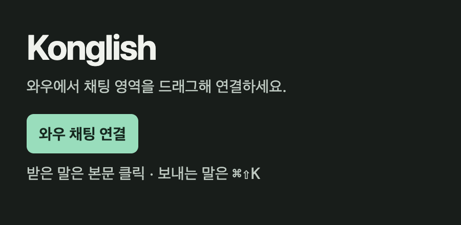
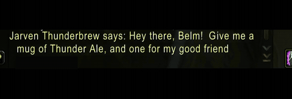

# WoW Forever Konglish

북미 와우 채팅을 한국어로 읽고 영어로 답하는 무료 Mac 앱입니다.

Mac 기본 오프라인 번역을 사용합니다. 로그인이나 번역 구독료 없이 쓸 수 있습니다.

## 설치

Apple Silicon 맥과 macOS 26 이상에서 사용할 수 있습니다.

[Mac 앱 다운로드](https://github.com/CodeNyangi/wowforever-konglish/releases/latest)에서 ZIP을 받아 압축을 풀고, **Konglish.app**을 **응용 프로그램**으로 옮겨 실행하세요.

처음 실행할 때 열기 안내가 나오면 **시스템 설정 → 개인정보 보호 및 보안 → 확인 없이 열기**에서 Konglish를 열어주세요. [처음 실행 방법](https://support.apple.com/ko-kr/102445)

**시스템 설정 → 일반 → 언어 및 지역 → 번역 언어**에서 **English (US)**와 **Korean**을 내려받으세요.

**시스템 설정 → 개인정보 보호 및 보안 → 손쉬운 사용**에서 **Konglish**를 허용하면 보내는 말도 자동으로 바꿀 수 있습니다.

## 사용법

Konglish에서 **와우 채팅 연결**을 누르고 와우 창을 공유한 뒤, **입력칸을 포함한 채팅 영역**을 드래그하세요.

**받은 말**은 영어 채팅 본문을 클릭하면 한국어로 바뀝니다. 다시 클릭하면 영어로 돌아옵니다.

**보낼 말**은 와우 채팅칸에 한국어를 쓰고 **⌘⇧K**를 누르면 영어로 바뀝니다. 확인한 뒤 **Enter**로 보내세요.





## 업데이트

메뉴 막대의 **Konglish → 업데이트 확인**을 누르면 새 버전을 받아두고, 다음에 앱을 열 때 적용합니다. 자동 업데이트를 켜두면 새 버전을 알아서 확인합니다.

업데이트 후 입력 권한을 다시 연결하려면 **손쉬운 사용** 목록에서 **Konglish를 −로 제거하고 +로 응용 프로그램의 Konglish.app을 추가**한 뒤 재실행하세요.

## 소스에서 실행

Node.js 22.12 이상과 macOS 26 SDK를 준비한 뒤 실행합니다.

```sh
npm ci
npm run install:mac
```

[MIT 라이선스](LICENSE)
